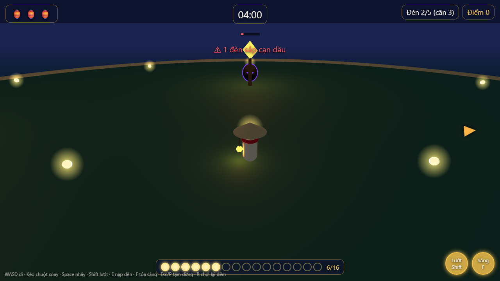
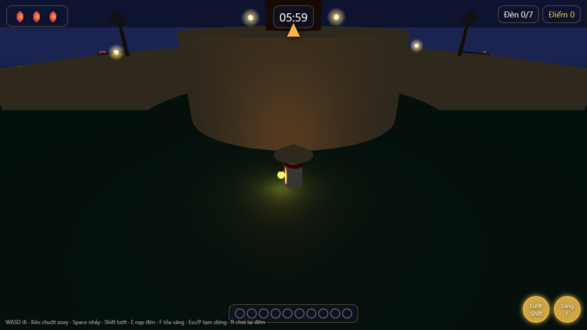
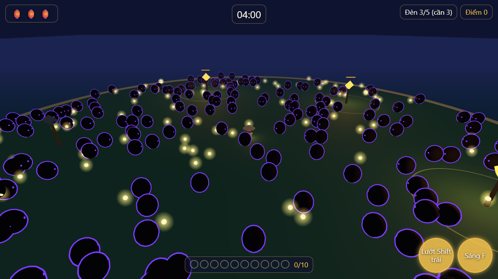

# Đảo Đèn Lồng — v1.0.0 "Bình minh"

Game 3D góc nhìn thứ ba: **Mây**, người giữ đèn nhỏ tuổi, gom đom đóm để thắp và **giữ sáng** các Đèn Lồng Lớn tới bình minh qua **3 Đêm** (Đảo Bến, Đảo Cau, Đảo Chuông), tránh **Bóng Mực** hút dầu và **Gió Lạc** cướp đom đóm. Logic tất định 60 tick/s ở `src/sim/` (chạy được không cần đồ họa), render bằng Three.js ở `web/`.

> **Video demo (3 phút 54):** [demo.mp4](https://github.com/bngcVu/K5-L3A-DAY12-BuiNgocVu-2A202603463-AI-SDLC-Dao-Den-Long/releases/download/v1.0.0/demo.mp4) · **Bản phát hành:** [v1.0.0](https://github.com/bngcVu/K5-L3A-DAY12-BuiNgocVu-2A202603463-AI-SDLC-Dao-Den-Long/releases/tag/v1.0.0) (có kèm bản web tĩnh `dao-den-long-web-v1.0.0.zip`)

| Đêm 1 — Đảo Bến, đèn yếu bị hút dầu | Đêm 3 — Đảo Chuông | Cảnh benchmark (200 Bóng Mực) |
|---|---|---|
|  |  |  |

## Yêu cầu hệ thống

- **Chơi:** Node.js ≥ 20 và một trình duyệt hiện đại có WebGL (Chrome, Edge, Firefox, Safari), macOS / Linux / Windows. Bản Docker hoặc web tĩnh không cần Node trên máy người chơi.
- **Benchmark:** thêm Chrome / Chromium / Edge cài sẵn (tự tìm, hoặc đặt `CHROME_PATH`).
- **Kiểm chứng đầy đủ:** thêm Python ≥ 3.8 (`python3` hoặc `python`).

## Cài đặt và chạy (3 lệnh)

```bash
npm install        # cài three.js
npm start          # mở http://localhost:8080
npm test           # (tùy chọn) 27 unit test
```

Không muốn cài Node? `docker build -t dao-den-long . && docker run --rm -p 8080:8080 -v ddl-data:/app/data dao-den-long`, hoặc dùng bản web tĩnh (`npm run build:web` rồi phục vụ `dist/web/`, ví dụ `python3 -m http.server -d dist/web 8080`; bảng xếp hạng lưu trong trình duyệt).

## Điều khiển (đổi được trong Cài đặt)

| Phím mặc định | Việc |
|---|---|
| W A S D | Đi (theo hướng camera) |
| Kéo chuột | Xoay camera (độ nhạy trong Cài đặt) |
| Space | Nhảy (chỉ khi chạm đất) |
| Shift trái | Lướt (14 m/s, 0.2 s, hồi 1.5 s) |
| E | Nạp đom đóm vào đèn gần nhất (trong 2 m): thắp đèn tắt hoặc châm dầu đèn đang sáng |
| F | Tỏa Sáng: choáng và đẩy lùi Bóng Mực trong 5 m (tốn 3 đom đóm, hồi 3 s) |
| Esc | Tạm dừng: Tiếp tục / Chơi lại Đêm / Cài đặt / Về menu |
| R | Chơi lại Đêm |

**Cài đặt:** âm lượng, độ nhạy chuột, đổi phím (báo trùng phím, khôi phục mặc định), bảng màu dễ phân biệt, giảm chuyển động, chữ lớn ×1.25. Mọi cài đặt được lưu giữa các lần mở.

## Luật chơi

- **Mục tiêu: giữ đảo sáng tới bình minh.** Đêm dài 240/270/300 s. Còn sống lúc hết giờ và còn ít nhất 3/5, 4/6, 5/7 đèn sáng thì thắng; thắp đủ đèn **không** kết thúc Đêm. Hết 3 Ngọn Lửa, hoặc hết giờ mà chưa đủ đèn thì thua (chơi lại Đêm đó).
- **Đèn có dầu** (0–100): thắp lần đầu cần 10 đom đóm, hao 1/giây; bấm E để châm dầu (mỗi đom đóm +10). Hết dầu đèn tắt; thắp lại chỉ cần 5. Đèn dầu ≥ 30 có vùng an toàn 6 m; dưới 30 thì nhấp nháy, mất vùng an toàn và thành mồi của Bóng Mực (chúng đứng hút 5 dầu/giây).
- Bóng Mực chạm: −1 Ngọn Lửa, rơi nửa số đom đóm, bất tử 1.5 s. Rơi khỏi đảo: −1 Ngọn Lửa, mất hết đom đóm, hồi sinh sau 1 s. **Gió Lạc** (Đêm 2, 3) cướp 3 đom đóm khi bạn mang ≥ 5; Tỏa Sáng làm nó bỏ chạy và thả lại. **Bùa Gió** cho 10 s chạy nhanh và lướt không hồi chiêu. Đêm 2 có bục nhảy bắn sang đảo kia; Đêm 3 có tầng, dốc, vách và gió mạnh mỗi 30 s.
- **Sức chứa** = 10 + 2 × số lần thắp thành công trong Đêm (tối đa 20).
- **Điểm:** +5 mỗi đom đóm nạp · +100 thắp lần đầu · +40 thắp lại · +5 mỗi Bóng Mực trúng Tỏa Sáng (+15 nếu đang hút dầu) · thắng ở bình minh: +50 + phần nguyên dầu mỗi đèn sáng, +50 mỗi Ngọn Lửa. Tổng điểm là tổng các Đêm đã thắng.
- **Bảng xếp hạng cục bộ** (top 10): sau màn Bình Minh hoặc khi thua, nhập tên 3–12 ký tự `A-Z a-z 0-9 _`. Xem từ menu chính. Lưu ở `data/leaderboard.json`.

## Kiểm chứng, headless, bench, soak

```bash
./scripts/check.sh --label phase-4          # unit test + 46 scenario headless (mỗi case chạy 2 lần so từng byte)
node src/headless.js --seed 1 --night 2 --ticks 600 --out out.jsonl   # --night 1|2|3, Test Contract v1.3
node bench/bench.js --seed 42 --duration 30 --out bench.json          # benchmark đồ họa (mở cửa sổ Chrome 1280×720)
node src/soak.js --seed 7 --nights 10 --out soak.json                 # 10 Đêm headless trong một tiến trình
node server.js --export-leaderboard out.json                          # xuất {"entries":[…]}  (hoặc: npm start -- --export-leaderboard out.json)
```

Khai báo lệnh trong [game.contract.json](game.contract.json) (v1.3: `build_cmd`, `run_cmd`, `headless_cmd`, `bench_cmd`, `soak_cmd`, `tuning`).

**Số đo tự chạy (máy dev: Windows 11, Intel Core i5-12450H, Intel UHD Graphics iGPU, 16 GB RAM; Chrome 158, cửa sổ 1280×720, vsync tắt bằng cờ dòng lệnh):**

| Phép đo | Kết quả | Ngưỡng ticket |
|---|---|---|
| Benchmark: `avg_fps` | **282.1** | ≥ 60 |
| Benchmark: `p1_low_fps` | **74.6** | ≥ 30 |
| Benchmark: `frame_ms_p95` / `frames` / `load_ms` | 6.3 ms / 8463 / 1580 ms | `load_ms` ≤ 10000 |
| Soak 10 Đêm: `crashes` / RSS đầu → cuối | **0** / 42.4 → 45.3 MB (**1.07×**) | 0 / ≤ 1.2× |
| Headless một Đêm đầy đủ (≤ 21.600 tick) | ≈ 0.3 s | ≤ 30 s |

Chi tiết: [evidence/phase-4/bench.json](evidence/phase-4/bench.json), [evidence/phase-4/soak.json](evidence/phase-4/soak.json). Đây là số **tự đo trên máy dev**, máy chấm của giảng viên có thể cho số khác. Ghi chú trung thực: (1) `peak_mem_mb` là `null` vì bản web chạy trong Chrome nhiều tiến trình; (2) `vsync_off` là `true` do truyền cờ tắt vsync, trình điều khiển có thể vẫn ép vsync (xem `vsync_note` trong `bench.json`); (3) soak khởi động nóng vài Đêm trước khi đo RSS đầu và gọi GC trước mỗi lần đo (heap thật ổn định ≈ 5 MB), tức là không đo cảnh JIT lạnh.

Tài liệu: tiêu chí nghiệm thu từng phase [docs/spec-phase-2.md](docs/spec-phase-2.md) · [spec/phase-3.md](spec/phase-3.md) · [spec/phase-4.md](spec/phase-4.md); quyết định thiết kế [adr/0001-den-can-dau-va-luat-thang.md](adr/0001-den-can-dau-va-luat-thang.md); [CHANGELOG.md](CHANGELOG.md); lý do sửa/xóa test [docs/changes.md](docs/changes.md); nhật ký dùng AI [docs/ai-log.md](docs/ai-log.md); retro [retro/retro.md](retro/retro.md); nguồn asset [CREDITS.md](CREDITS.md); giấy phép [LICENSE](LICENSE) (MIT).

## Sáng tạo của tôi

- **Cá Mây** (Phase 1): vài chú cá trắng tím bơi quanh đảo trong biển mây, **đã không còn** trên bản client mới (xem hạn chế).
- **Âm thanh tự tổng hợp** bằng WebAudio (nhạc nền ngũ cung ấm + hiệu ứng), không dùng asset ngoài.
- **Tia hút dầu**: Bóng Mực đang `drain` nối một tia tím/xanh tới đèn bị hút, để nhìn là hiểu đèn nào đang chết.
- Bằng chứng phần cũ vẫn đúng: tất cả phần thêm nằm trong `web/`, không import vào `src/sim`; `check.sh` vẫn 100 % đạt và 2 lần chạy giống hệt byte.

## Hạn chế đã biết (trung thực)

- **Chưa kiểm bằng tay trong trình duyệt thật:** menu → giới thiệu → kết quả → Bình Minh, nhập tên bảng xếp hạng, đổi phím, giảm chuyển động, chữ lớn, mũi tên chỉ hướng Bóng Mực, âm thanh. Logic đằng sau các tính năng này có unit test (bảng xếp hạng, thống kê bench, soak) nhưng giao diện chỉ được xem qua ảnh chụp headless.
- Docker image chưa được dựng thử trên máy dev. Release `v1.0.0` và video demo đã được tạo; cách tạo lại: [release/RELEASE.md](release/RELEASE.md).
- Chưa chạy thử trên macOS/Linux thật (phát triển trên Windows); GitHub Actions chạy `check.sh` + soak trên Ubuntu.
- Ticket Phase 2 không nêu điểm xuất phát Đêm 3 nên chọn (0,0,−12); các mơ hồ khác ở `spec/*.md` và `docs/spec-phase-2.md`.
- Bóng Mực đuổi theo đường thẳng, không tìm đường (có thể kẹt dưới vách tầng ở Đêm 3). Tên bảng xếp hạng chưa hỗ trợ tiếng Việt có dấu.
